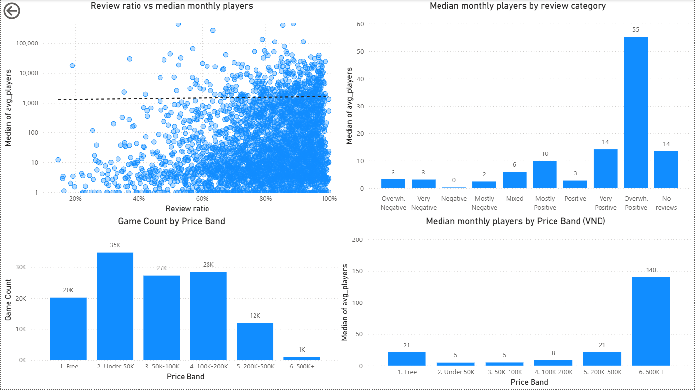

# Steam Games Market Analytics

An analysis of the Steam market: Python scripts collect game metadata and historical monthly player counts for 100K+ games, and a Power BI dashboard explores how price and review sentiment relate to player engagement.



## Key Findings

> Figures below are for all games with no filter applied. Selecting a bar in the dashboard filters the other charts and changes them.

- **Review sentiment and engagement:** "Overwhelmingly Positive" games have a median of **55 monthly players**, versus **14 or fewer** in every other review category.
- **Price and engagement:** The highest price band (500K+ VND) has the highest median monthly players, while the "Under 50K" band holds the most games.
- **Review ratio vs players:** The trend line on the scatter plot is nearly flat, so a higher review ratio alone does not clearly predict a higher player count.

These are patterns in the data, not causal claims.

## Conclusion

Across 100K+ Steam games, review sentiment shows the clearest link with engagement: "Overwhelmingly Positive" games have a median of 55 monthly players, against 14 or fewer in every other review category. The review ratio alone shows little relationship with player count (nearly flat trend line). These are associations, not causal effects.

## Next Steps

- **Break the results down by genre or release year.**
- **Look at spikes and drops in monthly players around sales or seasons.**

## Data

- **Game metadata:** Collected from the Steam Web API with a modified version of [Steam-Games-Scraper](https://github.com/FronkonGames/Steam-Games-Scraper) by FronkonGames. I added fields I needed (categories, positive and negative review counts).
- **Player history:** Monthly average and peak players per game, collected with my own script (based on a Stack Overflow example) from SteamCharts, then reshaped from wide to long format.
- **Cleaning:** Unused columns were dropped, and missing values and duplicate AppIDs were checked, before importing into the Power BI data model.
- **Scope:** Estimated ownership was left out of the analysis, since the project focuses on player engagement.
- **Currency:** Prices are in VND.

## Project Structure

```
.
├── data/        # Datasets (large files via Git LFS)
├── scripts/     # Modified Steam scraper (adds categories and review counts) and my SteamCharts player history script
├── dashboard/   # Steam_Player_Engagement.pbix: open in Power BI Desktop (free); click a bar in any chart to filter the others
├── images/      # Dashboard screenshot
└── README.md
```

## Tools

Python (Pandas, NumPy), Steam Web API, Power BI, Git

## Limitations

- Player counts come from a public third-party site (SteamCharts), not official Steam figures.
- Review sentiment and player count influence each other, so the findings show association, not cause.

## Author

Nguyễn Đức Trung · [GitHub](https://github.com/Trunk2004) · ductrung2029@gmail.com
